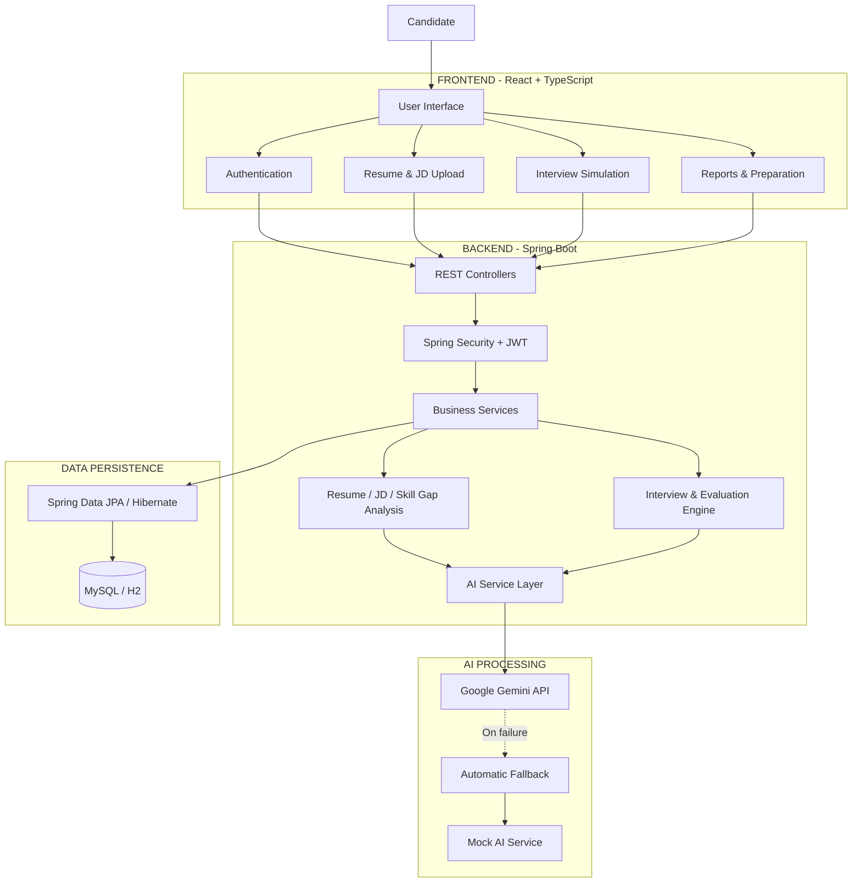

# AI Interview Preparation System
### AI-Powered Adaptive Interview Practice and Performance Evaluation Platform

An intelligent, full-stack interview preparation platform designed to help candidates prepare for technical interviews through personalized interview simulations, resume analysis, job description analysis, and AI-driven answer evaluation.

The system analyzes a candidate's resume and target job description to identify relevant skills, evaluate skill gaps, and generate contextual interview questions. It also supports adaptive interview sessions, speech-to-text answer input, detailed performance evaluation, and personalized preparation recommendations.

Built using **Java, Spring Boot, React, TypeScript, MySQL, and Google Gemini API**, the platform combines structured backend processing with AI-powered analysis to deliver a personalized interview preparation experience.

---

## 1. Key Features

### Authentication and User Management
- User registration and login.
- JWT-based authentication and authorization.
- Protected application routes.
- User-specific interview and document management.

### Resume Analysis
- Upload resumes in PDF format.
- Extract resume text using Apache PDFBox.
- Analyze extracted information using AI.
- Identify technical skills, experience, education, and professional domains.
- Store resume analysis results for subsequent interview preparation.

### Job Description Analysis
- Submit job descriptions for analysis.
- Extract required and preferred skills.
- Identify job roles, experience requirements, and relevant technical domains.
- Generate structured job requirement information.

### Skill Gap Analysis
- Compare candidate skills extracted from the resume against job requirements.
- Categorize skills into:
  - Matched Skills
  - Partially Matched Skills
  - Missing Skills
- Calculate an overall skill match percentage.
- Generate recommendations to improve missing or insufficiently demonstrated skills.

### AI-Powered Interview Simulation
- Generate personalized technical interview questions.
- Use resume information, target job role, job requirements, and interview context.
- Generate questions with expected key points and supporting evidence.
- Support adaptive interview sessions based on candidate responses.
- Maintain interview progress and question-answer history.

### Voice-Based Answer Input
- Support microphone-based answer input.
- Convert spoken responses into text using browser speech recognition.
- Display transcribed responses for interview submission.
- Support typed answers as an alternative.

### AI Answer Evaluation
- Evaluate submitted answers against interview questions and expected key points.
- Generate structured feedback.
- Assess answer quality, technical correctness, completeness, and clarity.
- Identify strengths and areas requiring improvement.

### Interview Reports and Performance Analysis
- Generate interview performance reports.
- Store interview evaluations and reports.
- Retrieve previous interview sessions.
- Track interview readiness and performance-related information.

### Personalized Preparation Plan
- Generate preparation recommendations based on identified skill gaps.
- Organize improvement areas into structured preparation plans.
- Retrieve previously generated preparation plans.

---

## 2. Technology Stack

| Layer | Technologies |
|---|---|
| Frontend | React 19, TypeScript |
| UI Framework | Bootstrap 5 |
| Backend | Java 21, Spring Boot 3.3.4 |
| Backend Architecture | Spring MVC, REST APIs |
| ORM | Hibernate, Spring Data JPA |
| Database | MySQL, H2 |
| Database Migration | Flyway |
| Authentication | Spring Security, JWT |
| AI Integration | Google Gemini API |
| AI Fallback | Custom MockAIService |
| PDF Processing | Apache PDFBox |
| API Documentation | Swagger / OpenAPI |
| HTTP Client | Axios |
| Routing | React Router |
| Data Fetching | TanStack React Query |
| Speech Recognition | Web Speech API |
| Build Tools | Maven, Vite |

---

## 3. System Architecture

The application follows a layered full-stack architecture.



---

## 4. Application Workflow

The platform follows a structured workflow to transform candidate documents and interview responses into personalized preparation recommendations.

### Step 1: User Authentication
- Candidate registers or logs into the application.
- Spring Security validates authentication.
- JWT tokens are used to authorize subsequent API requests.

### Step 2: Resume Processing
- Candidate uploads a PDF resume.
- The backend validates the uploaded file.
- Apache PDFBox extracts the textual content.
- The AI service analyzes the extracted information.
- Structured resume details and skills are persisted.

### Step 3: Job Description Processing
- Candidate submits a target job description.
- The backend processes its textual content.
- The AI service extracts required skills, preferred skills, role information, and experience requirements.
- The analysis results are stored.

### Step 4: Skill Gap Identification
- The candidate's extracted skills are compared with the job's required skills.
- Skills are classified as matched, partially matched, or missing.
- A skill match percentage is calculated.
- Recommendations are generated for improvement.

### Step 5: Interview Preparation
- The candidate initiates an interview session.
- The system prepares interview context using available resume, role, job description, and previous interview information.
- AI generates relevant questions with expected key points.
- Adaptive interview logic determines subsequent question selection.

### Step 6: Answer Submission and Evaluation
- The candidate submits a typed or transcribed answer.
- The backend retrieves the corresponding interview question and context.
- The AI service evaluates the response.
- Feedback and evaluation details are persisted.

### Step 7: Interview Reporting
- Interview evaluation information is used to generate a performance report.
- The candidate can review feedback, strengths, and improvement areas.
- Interview history and reports can be retrieved.

### Step 8: Preparation Recommendations
- The system uses skill-gap and readiness information to generate personalized preparation recommendations.
- The candidate can access the generated preparation plan.

---

## 5. Backend Architecture

The backend follows a layered architecture to separate API handling, business logic, data persistence, and AI integration.

| Layer | Responsibility |
|---|---|
| Controller | Handles HTTP requests and API responses |
| Service | Implements application business logic |
| Repository | Performs database operations using Spring Data JPA |
| Entity | Represents persistent database objects |
| DTO | Transfers structured request and response data |
| Security | Handles JWT authentication and authorization |
| AI | Integrates Gemini and deterministic mock AI services |
| Exception | Handles application errors and API exceptions |

### Important Backend Modules

- `auth` – Registration, login, and user authentication.
- `resume` – Resume upload, extraction, and analysis.
- `jd` – Job description processing and analysis.
- `skillgap` – Candidate skill comparison and gap identification.
- `interview` – Interview sessions, question generation, and answer submission.
- `preparation` – Personalized preparation plan generation.
- `readiness` – Interview readiness information and strategy.
- `ai` – AI provider abstraction, Gemini integration, and fallback handling.
- `security` – JWT authentication and authorization.

---

## 6. AI Integration and Fallback Mechanism

The application uses a dedicated AI service abstraction to separate AI operations from the core business logic.

**Google Gemini Integration**

The Gemini API is used for:
- Resume information extraction.
- Job description analysis.
- Contextual interview question generation.
- Candidate answer evaluation.
- Interview report generation.
- Readiness strategy generation.

The backend sends relevant contextual information to Gemini through HTTP requests and processes structured JSON responses into application-specific Java objects.

**AI Provider Architecture**

The system supports two AI providers:

1. `GeminiAIService` – Performs AI-powered processing using the Google Gemini API.
2. `MockAIService` – Provides deterministic responses for local development and testing.

`FallbackAIService` acts as a provider wrapper. When Gemini processing fails and fallback is enabled, the system automatically uses the mock provider.

This approach improves application resilience and allows interview workflows to continue even when the external AI provider is unavailable.

---

## 7. Database Design

The application uses Spring Data JPA and Hibernate for object-relational mapping.

MySQL is supported for persistent database storage, while H2 provides an in-memory database for local development.

### Major Database Entities

- User
- Resume
- ResumeAnalysis
- JobDescription
- JobDescriptionAnalysis
- Skill
- CandidateSkill
- JobRequiredSkill
- SkillGapAnalysis
- InterviewSession
- InterviewQuestion
- CandidateAnswer
- AnswerEvaluation
- InterviewReport
- PreparationPlan
- AuditLog
- Notification

### Database Management
- Hibernate manages entity-to-table mapping.
- Spring Data JPA provides repository-based database operations.
- Flyway manages version-controlled database migrations in the MySQL profile.
- H2 supports lightweight local development.

---

## 8. API Endpoints

The backend exposes REST APIs under the `/api/v1` base path.

| Module | Method | Endpoint | Purpose |
|---|---|---|---|
| Authentication | POST | `/auth/register` | Register candidate |
| Authentication | POST | `/auth/login` | Authenticate candidate |
| Authentication | GET | `/auth/me` | Retrieve current user |
| Health | GET | `/health` | Check backend health |
| Resume | POST | `/resume/upload` | Upload resume PDF |
| Resume | GET | `/resume/my` | Retrieve candidate resumes |
| Job Description | POST | `/jd/upload` | Submit job description |
| Job Description | GET | `/jd/my` | Retrieve job descriptions |
| Skill Gap | POST | `/skill-gap/analyze` | Analyze skill gaps |
| Skill Gap | GET | `/skill-gap/latest` | Retrieve latest analysis |
| Interview | POST | `/interview/start` | Start interview |
| Interview | POST | `/interview/adaptive/start` | Start adaptive interview |
| Interview | GET | `/interview/my` | Retrieve interview history |
| Interview | POST | `/interview/{id}/answer/{questionId}` | Submit answer |
| Interview | POST | `/interview/{id}/report` | Generate interview report |
| Interview | GET | `/interview/{id}/report` | Retrieve interview report |
| Preparation | GET | `/preparation-plan` | Retrieve preparation plan |
| Preparation | POST | `/preparation-plan/generate` | Generate preparation plan |
| Readiness | GET | `/readiness` | Retrieve readiness information |
| Readiness | POST | `/readiness/refresh` | Refresh readiness information |

For complete request and response schemas, use the Swagger documentation.

---

## 9. Project Structure

```text
smart-interview-platform/
│
├── backend/
│   ├── src/
│   │   ├── main/
│   │   │   ├── java/com/smartinterview/
│   │   │   │   ├── ai/
│   │   │   │   ├── config/
│   │   │   │   ├── controller/
│   │   │   │   ├── dto/
│   │   │   │   ├── entity/
│   │   │   │   ├── exception/
│   │   │   │   ├── interview/
│   │   │   │   ├── jd/
│   │   │   │   ├── preparation/
│   │   │   │   ├── readiness/
│   │   │   │   ├── repository/
│   │   │   │   ├── security/
│   │   │   │   ├── service/
│   │   │   │   └── skillgap/
│   │   │   └── resources/
│   │   │       ├── db/migration/
│   │   │       └── application.yml
│   │   └── test/
│   └── pom.xml
│
├── frontend/
│   ├── src/
│   │   ├── components/
│   │   ├── context/
│   │   ├── pages/
│   │   ├── services/
│   │   ├── types/
│   │   ├── App.tsx
│   │   └── main.tsx
│   ├── package.json
│   └── vite.config.ts
│
└── README.md

```

---

## 10. Project Objective

The objective of this project is to make interview preparation more personalized, structured, and measurable.

By combining resume analysis, job requirement matching, adaptive interview simulations, speech-based answer input, and AI-generated feedback, the platform helps candidates understand their technical strengths, identify skill gaps, and improve their interview readiness.

<p align="center">
  <strong>Built to make interview preparation smarter, more adaptive, and more effective.</strong>
</p>
